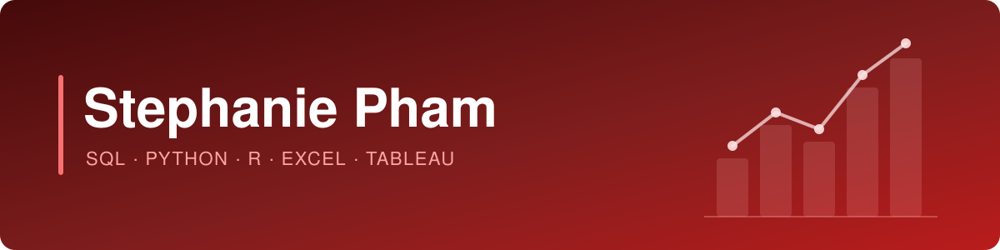

  

 

## About Me

I'm a Quality Control Systems Analyst moving into **data analytics**. I have 5+ years of experience in logistics, government contracting, and healthcare operations, working with contract and pricing data, cost models, budgets and forecasts, and laboratory data systems. I hold a B.S. in Biological Engineering and a Business Analytics Certification from the University of Georgia.

## Performance Highlights

- **Data Quality Control** — reviewing contract and pricing data for accuracy and resolving issues before execution
- **Cost Modeling & Estimation** — building cost models for federal proposals and pricing 136–160 quotes a month
- **Budgeting & Forecasting** — managing budgets, forecasts, and schedules across multiple Department of Defense contracts
- **Data Systems Integration** — leading the design and integration of a laboratory information management system (LIMS) and middleware that eliminated manual data entry
- **Business Requirements** — creating and modifying requirements for contract and pricing applications
- **Process Documentation** — co-authoring SOPs to standardize onboarding and workflows
- **Stakeholder Collaboration** — coordinating across sales, vendors, technical teams, and leadership

## Proven Results

| | Highlight | Where |
|---|---|---|
| **01** | Completed **293+ service orders** (165 emergency) while managing DoD maintenance contracts | Project Coordinator |
| **02** | Generated an average of **136–160 quotes per month** for medical gas systems | Estimator |
| **03** | Led **LIMS design and integration**, building middleware to unify platforms | Lab Systems & Data Manager |
| **04** | Built **cost models** for federal contract proposals, integrating labor wage determinations | Cost Coordinator |

## Tools & Skills

**Data & Analytics**

**Business Systems**

**Analysis & Planning**

## Education & Certifications

---
